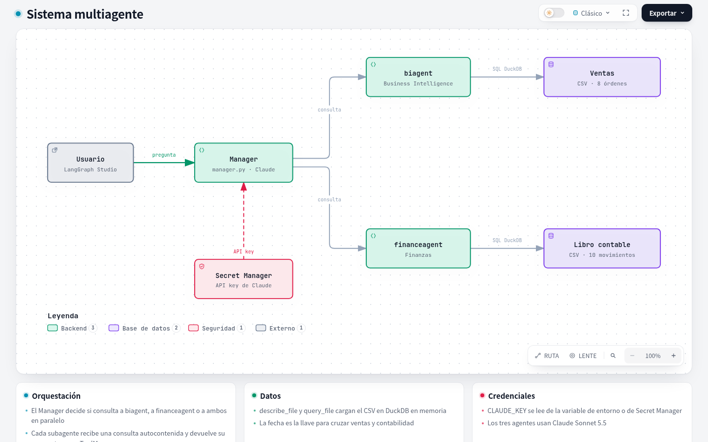

<div align="center">

# Subagents

**Hazle preguntas a tus ventas y a tus finanzas.**

Un manager de LangGraph que delega en dos analistas y cruza sus respuestas.


</div>

---

```text
Tú:       ¿Las ventas del 1 al 4 de octubre cubren los gastos operativos?
Manager:  No. El periodo cierra con una pérdida de 1.220. Corporativo es el canal
          con más margen (1.250), pero ninguno por sí solo cubre la nómina (3.200).
          (Fuentes: biagent · ventas / financeagent · libro contable)
```

El manager decide si la pregunta es de ventas, de finanzas o de ambas, y consulta al analista correcto. Usa solo las cifras que le devuelven. Si un dato no está en tus archivos, te lo dice.

## Inicio rápido

```bash
git clone https://github.com/<tu-usuario>/subagents.git
cd subagents

uv venv .venv && source .venv/bin/activate
uv pip install -r requirements.txt

gcloud auth application-default login
export CLAUDE_KEY=<tu-api-key>
langgraph dev
```

Se abre **LangGraph Studio** en el navegador, listo para chatear con el manager.

> Si no defines `CLAUDE_KEY`, la API key se lee del secreto `CLAUDE_KEY` en Secret Manager del proyecto `GOOGLE_CLOUD_PROJECT`.

## Cómo funciona



| Herramienta | Qué hace |
|---|---|
| `biagent` | Analista de ventas: canales, regiones, clientes, categorías y tickets. |
| `financeagent` | Analista financiero: ingresos, COGS, OPEX, nómina y márgenes. |
| `describe_file` | Muestra las columnas y filas de ejemplo de un archivo de datos. |
| `query_file` | Ejecuta SQL de DuckDB sobre el archivo, en memoria y sin acceso externo. |

[Ver el diagrama interactivo →](docs/arquitectura.html)

> **Trazabilidad en LangGraph Studio.** Los subagentes se invocan dentro de las herramientas `biagent` y `financeagent`, así que LangGraph no puede descubrirlos de forma estática. En Studio solo verás el grafo del manager y la respuesta final de cada analista: no aparecen sus consultas SQL, sus pasos intermedios ni su estado, y `get_state(subgraphs=True)` no lo devuelve ([documentación](https://docs.langchain.com/oss/python/langchain/multi-agent/subagents#subagent-outputs)).
>
> Para verlo tienes dos opciones:
> - **Pasar el estado al manager:** devuelve claves extra en el `Command` de la herramienta (por ejemplo, las consultas ejecutadas) además del `ToolMessage`.
> - **Visualizarlo de forma custom:** invoca cada subagente desde una función de nodo en un grafo propio, en vez de desde una herramienta. Así Studio y `get_state(subgraphs=True)` sí muestran su estado.

## Preguntas sugeridas

<details>
<summary><b>Ventas</b> · <code>biagent</code></summary>

| Pregunta | Respuesta esperada |
|---|---|
| ¿Cuánto vendió cada canal de venta? | Corporativo 5.750, Online 4.100 y Tienda Física 3.770. |
| ¿Qué región tuvo más ventas? | Este, con 6.350. Le siguen Norte con 4.020 y Sur con 3.250. |
| ¿Qué cliente compró más de una vez y cuánto gastó en total? | C-501, con 2 órdenes y 3.650 en total. |
| ¿Cuántas unidades se vendieron por categoría de producto? | Accesorios 14, Laptops 8, Smartphones 4 y Monitores 2. |
| ¿Cuál es el ticket promedio por orden? | 1.702,50 (13.620 entre 8 órdenes). |

</details>

<details>
<summary><b>Finanzas</b> · <code>financeagent</code></summary>

| Pregunta | Respuesta esperada |
|---|---|
| ¿Cuánto sumaron los gastos operativos (OPEX) del periodo? | 4.700: 1.500 de marketing y 3.200 de nómina. |
| ¿Cuál fue la utilidad bruta contable y su margen? | 3.480 (13.620 − 10.140), con un margen del 25,5 %. |
| ¿Cuál fue el resultado neto del 1 al 4 de octubre? | Una pérdida de −1.220. |
| ¿Qué día registró más ingresos en la cuenta 4001? | El 2 de octubre, con 6.000. |
| ¿Cuánto gastó cada departamento? | Operaciones 10.140 (COGS), RRHH 3.200 y Marketing 1.500. |

</details>

<details>
<summary><b>Cruzadas</b> · ambos agentes</summary>

| Pregunta | Respuesta esperada |
|---|---|
| ¿Las ventas del 1 al 4 de octubre cubren todos los gastos operativos? ¿Qué canal aporta más margen? | No los cubren: hay una pérdida de 1.220. El canal con más margen es Corporativo, con 1.250. |
| ¿Algún canal, por sí solo, genera suficiente margen para pagar la nómina? | Ninguno, porque la nómina es de 3.200. Los tres juntos suman 3.480. |
| ¿Qué pasó el 4 de octubre? Explícame el resultado del día. | Un margen de 550 frente a 4.700 de gastos: una pérdida de 4.150. |
| ¿Qué retorno tuvo la campaña de Ads del 4 de octubre sobre las ventas online de ese día? | Un margen online de 200 frente a 1.500 de gasto, es decir, un ROI de aproximadamente −87 %. |
| ¿Qué categoría tiene mejor margen porcentual y cuánto representa del ingreso contable? | Accesorios, con un margen del 62 %, aunque solo representa el 2,7 % del ingreso. Laptops representa el 69 %. |
| ¿Cuánto del ingreso contable viene del cliente C-501 y es rentable? | 3.650, el 26,8 % del ingreso, con un margen de 950. |
| ¿Las ventas de BI coinciden con los ingresos y costos contables día por día? | Sí, coinciden en los cuatro días. |

</details>

## Usa tus propios datos

1. Copia tu archivo (`.csv`, `.tsv`, `.parquet` o `.json`) en `agents/<agente>/resources/`.
2. Descríbelo en el diccionario `FILES` de `agents/<agente>/prompt.py`: qué representa cada fila y sus columnas.

## Estructura

```text
manager.py                  # Manager: reglas de delegación y formato de respuesta
agents/
├── business_intelligence/
│   ├── agent.py            # Modelo y herramienta biagent
│   ├── tools.py            # describe_file, query_file
│   ├── prompt.py           # Reglas del analista y archivos disponibles
│   └── resources/          # Datos de ventas
└── finance_agent/
    ├── agent.py            # Modelo y herramienta financeagent
    ├── tools.py            # describe_file, query_file
    ├── prompt.py           # Reglas del analista y archivos disponibles
    └── resources/          # Libro contable
credentials/credentials.py  # Lectura de la API key
langgraph.json              # Configuración de LangGraph
```
